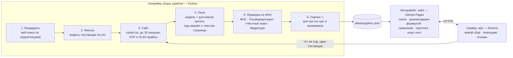

# supplier-scout — поиск поставщиков для ресторана

Сервис помогает закупщику сети ресторанов или владельцу точки найти поставщика продуктов и упаковки и решить, кому написать первым. Условия поставщика — минимальный заказ, цены, доставка, документы, контакты — сведены в одну карточку, и у каждого значения есть источник: цитата со страницы сайта или запись государственного реестра.

Тестовое задание для Goulash.tech на роль AI Automation Specialist, часть 2.

**Прототип: https://afest.github.io/supplier-scout/** — открывается без входа, данные уже собраны.
Сервер живого сбора, помощника и отзывов — https://supplier-scout-api-afest.msk1.amvera.tech (адрес `/health` показывает, жив ли он и сколько платных действий осталось на сегодня).

- 60 реальных поставщиков Екатеринбурга в четырёх категориях: упаковка для доставки (30), рис и азиатская бакалея (14), рыба и морепродукты (10), сыр и молочное (6). Придуманных поставщиков и значений нет: чего нет в открытых источниках, то помечено «не найдено» или «◇ оценка по рынку».
- «Кому написать первым» считает формула с весами, а не модель. Каждый балл раскладывается на строки, в карточке видно, почему поставщик выше или ниже.
- Живой сбор: вставьте сайт или ИНН поставщика не из набора, и сервер соберёт его карточку тем же конвейером за 2–4 минуты.
- Помощник: опишите точку словами («у меня бабл-ти на фудкорте»), он предложит, что понадобится, а поставщиков подберёт код по ассортименту набора.

## Для кого

Основной пользователь — закупщик сети ресторанов: суши, пицца, кафе. Поставщика ищут, когда открывается точка, меняется меню или текущий поставщик подвёл. Сейчас это поиск в Яндексе и 2ГИС и звонки: десяток сайтов, условия выписываются в таблицу, половина выясняется только по телефону. Сети важны документы для проверок Роспотребнадзора, счета с НДС и доставка до точки.

Второй пользователь — владелец одной точки. Закупщика нет, объёмы маленькие, главный вопрос: примут ли заказ и привезут ли завтра.

Сервис сводит условия со всех сайтов в одну форму, помечает, что подтверждено реестром, а что известно только со слов поставщика, и подсказывает, кому писать первым и что спросить в первом письме.

## Сценарии

**Сеть ищет контейнеры под доставку.** «Поиск по категории» → «Упаковка для доставки» → подкатегория. Закупка в неделю по умолчанию 20 000 ₽, её и «что важнее» можно поменять. Сверху — три карточки «Кому написать первым»: у каждой строка «почему» и строка «что уточнить». Ниже весь список с фильтрами: доставка до точки, компания действует, минимальный заказ до N ₽. Троих можно отметить и сравнить: лучшее известное значение в строке помечено ▲, «не найдено» не выигрывает и не проигрывает. В карточке под каждым значением цитата и ссылка на страницу, ниже — данные ФНС и декларации из реестра. Из шорт-листа — черновик письма с вопросами ровно по пустым полям.

**Точка срочно меняет поставщика рыбы.** «Поиск по категории» → «Рыба и морепродукты» → «Лосось, сёмга, форель». Или «Поиск по товару» → «лосось»: он ищет по ассортименту поставщиков и прощает опечатки. «Что важнее» → «Быстрая доставка», и вес доставки становится главным; фильтры «склад в Екатеринбурге» и «доставка до точки» оставляют тех, кто привезёт сам. У рыбы, морепродуктов и молочного вес документов выше всегда: без них закупка невозможна. Поставщика отмечаете звёздочкой, после звонка ставите статус «Ответил» и заметку — они видны и в карточке, и в шорт-листе.

**Поставщик уже на примете.** «Знаю поставщика» → сайт или ИНН. Сервер собирает карточку, шаги видны по ходу. Через 2–4 минуты карточка с пометкой «собрано сейчас» встаёт в выдачу категории рядом с остальными. «Почему такой порядок» показывает веса и баллы по каждому критерию; переключите «что важнее», и порядок меняется.

**Точка только открывается.** «Помощник» → «у меня бабл-ти» → что может понадобиться: молоко, чай, стаканы с купольной крышкой. По каждому варианту — поставщики из набора, у которых это есть в ассортименте. Модель не видит названий поставщиков и не может назвать того, кого нет в наборе; чего в наборе нет, помощник так и говорит и предлагает живой сбор. Если описание неоднозначное, модель задаёт один уточняющий вопрос («Пончики жарите на месте или привозите готовыми?») с вариантами ответа кнопками; ответ уходит на сервер вместе с описанием одним текстом, истории диалога сервер не хранит.

Шорт-лист, статусы и заметки хранятся в браузере, без входа; шорт-лист выгружается в CSV. Экран «Как собраны данные» показывает источники и полноту по полям прямо в прототипе.

## Как это работает



Набор собирается заранее и лежит в репозитории JSON-файлом. Интерфейс — статика: формула, фильтры и сравнение считаются в браузере, для просмотра сервер не нужен. Сервер отвечает за три вещи, которым нужна модель или общая память: живой сбор одного поставщика, помощник и отзывы.

Главное правило конвейера — шаг 4. Модель возвращает значение вместе с дословной цитатой и номером страницы, код ищет цитату в тексте страницы и сверяет с ней значение: числа, слова адреса и условий, единицу минимального заказа, да/нет в доставке. Не сошлось — значение отбрасывается, поле становится «не найдено». В последнем прогоне код отбросил так 122 значения модели на 76 сайтах. Вписать в карточку то, чего нет на странице, модель не может.

Статусы полей различаются формой знака, а не цветом: ● найдено в реестре · ◐ со слов поставщика · ○ не найдено · ◇ оценка по рынку · ✎ вручную.

## Откуда данные и как мы их искали

### Что пробовали

| Источник | Что даёт | Решение |
|---|---|---|
| Веб-поиск → сайты самих поставщиков | кандидаты по подкатегории и городу | **Взяли.** Остальные данные — с сайтов и из реестров |
| 2ГИС Places API | название, адрес, рубрики; телефоны и сайты — отдельная платная опция по договору | Не взяли: оферта запрещает хранить и кэшировать ответы. В карточке — ссылка «на карте» |
| Яндекс, поиск по организациям | название, адрес, сайт, телефоны | Не взяли: от 20 800 ₽ в месяц, показывать можно только на Яндекс Картах |
| B2B-каталоги: Пульс цен, supl.biz, Поставщики.ру, optlist | списки поставщиков | Не взяли: защита от ботов на всех, Пульс цен поимённо закрыл robots.txt для ботов Claude и GPT. Обходить не стали |
| Парсеры карт (Apify) | телефоны, сайты, иногда ИНН | Не взяли: против соглашений 2ГИС и Яндекса |
| Сайты поставщиков | условия, цены, доставка, контакты, ИНН в реквизитах | **Главный источник полей.** robots.txt соблюдается, храним цитаты, а не копии страниц |
| ФНС: «Прозрачный бизнес», бухотчётность | статус, возраст, ОКВЭД, выручка, флаги «массовый адрес», «недостоверный адрес», налоговый режим | **Взяли**, бесплатно по ИНН |
| Росаккредитация, реестр деклараций | номер, статус, срок, продукция | **Взяли** |
| «Честный знак» | группы маркировки: молочное, морепродукты | **Взяли** для рыбы и молочного |
| Федресурс | банкротство | **Взяли** — это стоп-условие |
| ВетИС («Меркурий») | ветеринарные документы | Не автоматизировали: по ИНН публично не ищется. В карточке подсказка попросить документы у поставщика |

### Воронка

23 поисковых запроса → 208 ссылок → 120 сайтов → 97 после отсева каталогов, карт, маркетплейсов и справочников по домену → 79 модель по главной странице признала поставщиками (отсеяны розница, агрегаторы, ресторан, сайты, которые не открылись) → 76 с товарами наших категорий разобраны по полям → 62 работают в Екатеринбурге (14 возят только по Москве, Татарстану и другим регионам) → **60 в наборе и 2 для показа живого сбора**.

### Полнота по полям, 60 поставщиков

| Поле | Есть | Заметка |
|---|---|---|
| Сайт, email | 60 | |
| Телефон | 58 | |
| Адрес или склад | 59 | у 18 — из реестра ФНС |
| Ассортимент | 59 | 4 631 позиция с каталогов и прайсов, названия сверены со страницей |
| Часы работы и доставки | 45 | фразы со страниц, разобранные шаблонами, без модели |
| Юрлицо | 48 | у 36 — из реестра ФНС |
| ИНН | 34 | модель плюс шаблон «ИНН …» на страницах реквизитов, оферты и политики |
| Компания в ФНС | 36 | у 13 флаги не проверены: ФНС попросила капчу |
| Оплата и отсрочка | 37 | |
| Цены | 41 | прайс у 19, цены на часть позиций у 3, «по запросу» у 17, после входа у 2; ещё у 22 — ориентир ◇ |
| Доставка | 34 | |
| Минимальный заказ | 26 | ещё у 26 — оценка ◇: медиана известных минимумов категории |
| Документы | 23 в реестре | ещё у 37 упомянуты на сайте |
| Налоговый режим | 23 | только из «Прозрачного бизнеса» |

Сбор набора стоил около 56 ₽: 167 вызовов Claude Haiku 5.5. Реестры и загрузка страниц бесплатны.

### Ограничения

- **Кандидатов нашёл не сам сервис.** Набор собран из выдачи веб-поиска Claude Code (расширенный режим), записанной в [`data/seed/`](data/seed/): 23 запроса, ссылки только из результатов поиска. Автоматический поиск в конвейере написан (`--provider gemini`: Gemini с поиском Google через Kie), но 13.10 Kie отвечал на нём ошибкой 500, а Яндекс Search API к сроку не подключили. Всё дальше — фильтр, сайты, поля, реестры, оценки — сделал конвейер.
- **ФНС «Прозрачный бизнес» включает капчу** после примерно 25 запросов подряд. Обходить её не стали. У 13 компаний флаги ФНС помечены «не проверены» и в балл идут как неизвестное, а не как нарушение. Повторный прогон в другой день добирает их бесплатно.
- **Оценки ◇.** Минимальный заказ и цены «по запросу» в части карточек — ориентир по рынку с подписью, на чём он основан. В балл оценка идёт как неизвестное.
- **Один город, снимок на 14.10.2026.** У каждой карточки дата сбора; данные старше 30 дней теряют 20 % балла полноты.
- **Слабые категории.** Сыр и рис: местных поставщиков мало, в набор вошли федеральные с доставкой в Екатеринбург.
- **Закрытое не собираем.** Страница под robots.txt даёт в карточке «не собрано: сайт запрещает сбор», а не «не найдено».
- **Расхождения страниц** одного сайта пока не показываются: место под второе значение в контракте данных есть, конвейер его не заполняет.

## Как считается рекомендация

Порядок считает формула, а не модель: одинаковые данные дают одинаковый порядок, и каждый балл раскладывается на строки на экране «Почему такой порядок». Код — [`web/src/lib/score.ts`](web/src/lib/score.ts).

**1. Стоп-условия.** Поставщик уходит в свёрнутый список «Исключены» с причиной, если компания ликвидирована или в банкротстве (ФНС, Федресурс), если он не возит в Екатеринбург и склада в городе нет, если конвейер решил, что это не поставщик. Последнее можно отменить руками.

**2. Шесть критериев**, оценка каждого от 0 до 1:

| Критерий | Как считается |
|---|---|
| Надёжность компании | возраст `min(лет / 5, 1) × 0,5` + ОКВЭД по категории `0,2` + нет красных флагов ФНС `0,3`; флаги не проверены из-за капчи — треть от `0,3` |
| Документы на продукцию | действующая декларация на продукцию этой категории или группа «Честного знака» → 1; декларации на другую продукцию или только упоминание на сайте → 0,5 |
| Минимальный заказ | не больше закупки в неделю → 1; до двух закупок → 0,5; больше → 0,1. Минимум в кг и шт переводится в рубли по ориентиру цены категории, без ориентира — порогами (до 10 кг или 50 шт — мелкий, больше 100 кг или 500 шт — крупный опт). Закупка не задана — место в категории от меньшего минимума к большему |
| Доставка | до точки бесплатно при такой закупке → 1; бесплатно от N штук → 0,85; до точки платно или стоимость не указана → 0,7; только самовывоз → 0,5; склад в другом городе, транспортной компанией → 0,2 |
| Прозрачность цен | прайс на сайте → 1; цены на часть позиций → 0,6; по запросу или после входа → 0,2 |
| Полнота и свежесть | доля найденных полей из 19; старше 30 дней — × 0,8 |

**Неизвестное — треть балла**, не ноль и не полный. Ноль наказывал бы поставщиков с бедными сайтами, которые часто нормально работают. Полный балл поощрял бы молчание. Значение «со слов поставщика» ◐ считается полностью, оценка ◇ — как неизвестное.

**3. Веса** — по выбору «что важнее»:

| Критерий | Сбалансированно | Надёжность и документы | Условия и цена | Быстрая доставка |
|---|---|---|---|---|
| Надёжность | 25 | 30 | 15 | 15 |
| Документы | 20 | 35 | 10 | 15 |
| Минимальный заказ | 20 | 10 | 30 | 15 |
| Доставка | 15 | 10 | 15 | 40 |
| Прозрачность цен | 10 | 5 | 25 | 5 |
| Полнота и свежесть | 10 | 10 | 5 | 10 |

Для рыбы, морепродуктов и молочного вес документов +10, за счёт полноты (−5) и цен (−5).

**4. «Кому написать первым»** — три лучших по баллу, кроме крупного опта: если минимальный заказ больше закупки в 5 раз и больше, поставщик остаётся в списке с пометкой «крупный опт», но в тройку не попадает. Текст «почему» и «что уточнить» собирается шаблоном из самых больших вкладов в балл и самого весомого пробела ([`web/src/lib/explain.ts`](web/src/lib/explain.ts)). Модель текст не пишет, поэтому не может приписать поставщику то, чего нет в полях.

**Пример.** Упаковка для доставки, закупка 20 000 ₽ в неделю, «сбалансированно», данные на 14.10.2026. Первым идёт U2B «Упаковка для бизнеса»:

| Критерий | Вес | Оценка | Вклад | Из чего |
|---|---|---|---|---|
| Надёжность | 25 | 1 | 25 | действует 11 лет, ОКВЭД совпадает, красных флагов нет |
| Документы | 20 | 0,5 | 10 | только упоминание на сайте |
| Минимальный заказ | 20 | 1 | 20 | от 100 шт ≈ 2 300 ₽ по ориентиру цены — меньше закупки |
| Доставка | 15 | 1 | 15 | до точки бесплатно от 3 000 ₽, в тот же день при заказе до 11:00 |
| Прозрачность цен | 10 | 1 | 10 | прайс на сайте |
| Полнота | 10 | 0,95 | 9,5 | 18 из 19 полей |
| **Итого** | | | **89** | |

Дальше по баллу Almin.ru (80) и УБпластиК (75), но УБпластиК в тройку не попадает: минимум 4 800 штук ≈ 108 000 ₽, в 5,4 раза больше закупки. Третьим в «Кому написать первым» становится WebPack (70), УБпластиК остаётся в списке с пометкой «крупный опт».

## Почему такой формат и стек

- **Набор, собранный заранее, плюс живой сбор одного поставщика.** Сбор на каждый запрос — это 2–5 минут ожидания, 10–25 ₽ и пустой экран при любом сбое поиска, модели или гос-сайта. Набор открывается сразу, а конвейер вживую показан там, где ожидание оправдано: на одном поставщике. Состав поставщиков в категории меняется медленно, в продукте набор обновлялся бы по расписанию.
- **Порядок решает формула, модель делает остальное.** Формула воспроизводима и объясняется построчно. Модель делает то, что без неё не сделать: раскладывает свободный текст сайта по полям (с проверкой цитатой) и понимает описание точки в помощнике.
- **Модель — Claude Haiku 5.5 через Kie.** Дешёвая и отвечает из РФ. Адаптер [`pipeline/kie.py`](pipeline/kie.py) позволяет заменить её на другую.
- **Интерфейс — Vite + React + TypeScript, статика.** Маршруты через `#`, поэтому сайт работает с GitHub Pages без сервера.
- **Данные — JSON-файл в репозитории.** 62 записи, база не нужна, изменения набора видны в истории git.
- **Хостинг выбран замером из РФ.** GitHub Pages и Amvera открылись с трёх российских узлов из трёх, Vercel и Cloudflare Pages — с одного. Сервер стоит в РФ потому, что с зарубежного VPS не открылись реестр Росаккредитации и 8 из 18 сайтов поставщиков.
- **RAG и векторной базы нет.** Извлечение полей из страницы — не поиск по базе знаний, а помощнику хватает сопоставления с ассортиментом.

## Сервер

| Адрес | Что делает |
|---|---|
| `GET /health` | жив ли сервер, сколько действий демо-стенда осталось сегодня |
| `POST /collect`, `GET /jobs/{id}` | живой сбор по сайту или ИНН: очередь поверх `python -m pipeline.one`, шаги и готовая карточка |
| `POST /assist`, `POST /assist/match` | помощник: описание точки → варианты → поставщики набора |
| `GET /reviews`, `GET /reviews/{id}`, `POST /reviews/{id}` | отзывы закупщиков |
| `GET /probe` | отвечают ли источники конвейера с сервера |

Лимиты демо-стенда: 5 живых сборов и 10 диалогов помощника в сутки на весь стенд (обнуляются в полночь по Екатеринбургу), потолок модели — 10 ₽ в день, плюс лимит на адрес. Когда лимит исчерпан, интерфейс говорит об этом у кнопки.

Что сервер хранит: отзывы — оценку, текст, имя, если его указали, и дату — в SQLite на диске Amvera. IP-адрес не хранится: только хеш с солью, чтобы считать «один отзыв с адреса в сутки». Лимиты на адрес живут в памяти процесса. Модерации в прототипе нет. Карточки живого сбора возвращаются в браузер, в общий набор не попадают.

## Что дальше

- **Поиск кандидатов самим сервисом** (Яндекс Search API или Gemini с поиском) и обновление набора по расписанию, раз в неделю; на карточке — кнопка «Обновить данные».
- **«Найти новых в категории» и любой город** — фоновой задачей тем же конвейером.
- **Связка со складом.** Остатки и расход из учётной системы ресторана (iiko, 1С, ERP холдинга) → какая позиция кончается и сколько заказать → поставщики, у которых она есть в ассортименте → черновик заказа тем, у кого лучшие условия. Помощник в этой схеме получает не описание словами, а позиции из техкарт.
- **Аккаунты сети:** общий шорт-лист для закупщиков, история заказов, свои отзывы с модерацией.
- **Расхождения между страницами сайта** — оба значения в карточке.
- **ФНС без капчи:** DaData как запасной источник.

## Запуск

Интерфейс на Windows — двойной клик по `dev.bat`: при первом запуске поставит зависимости, поднимет сервер и откроет браузер. Вручную:

```bash
cd web
npm install
npm run dev        # http://127.0.0.1:5173; помощник, отзывы и живой сбор ходят на сервер Amvera
npm run build      # статика в web/dist, открывается и с GitHub Pages
```

Адрес сервера задаётся при сборке: `VITE_API_URL=http://127.0.0.1:8000 npm run dev`. По умолчанию — сервер на Amvera.

Сервер локально (Python 3.12):

```bash
pip install -r requirements.txt
python -m uvicorn api.main:app --port 8000
```

Сайт на GitHub Pages собирает и выкладывает [`.github/workflows/pages.yml`](.github/workflows/pages.yml) при каждом push в `main`. Сервер на Amvera — `powershell -File scripts\deploy-amvera.ps1`.

## Конвейер сбора

`pipeline/` на Python 3.12 собирает `data/suppliers.json`. Зависимости — httpx, lxml, pypdf и openpyxl.

```bash
pip install -r requirements.txt
python -m pipeline.selftest                 # правила проверки цитат, ИНН, часов, ассортимента, robots.txt — без сети и без модели
python -m pipeline.run --budget-rub 100     # весь сбор; потолок — на расход этого прогона; отчёт — data/runs/<дата>.json
python -m pipeline.run --offline            # пересборка из кэша: без модели и без сайтов, ключ Kie не нужен
```

`--offline` не вызывает модель и не открывает сайты — только кэш в `pipeline/.cache/`. Реестры по ИНН бесплатны, поэтому и в этом режиме запросы, которые в прошлый раз не прошли (капча ФНС), повторяются. Отчёт второго прогона за день пишется рядом (`<дата>-2.json`), прошлый не затирается.

| Шаг | Что делает | Чем |
|---|---|---|
| 1. Кандидаты | веб-поиск по подкатегориям и городу; карты, каталоги, маркетплейсы и соцсети отсеиваются по домену | `--provider gemini` — Gemini с поиском Google через Kie, ссылки только из источников поиска; `--provider seed` — выдача поиска, записанная в `data/seed/` |
| 2. Фильтр | по главной странице: поставщик, агрегатор, розница, ресторан или статья | Claude Haiku 5.5 через Kie, пачками по 10 сайтов |
| 3. Сайт | главная и до пяти страниц: контакты, доставка, реквизиты, опт, прайс; robots.txt по RFC 9309 (не открылся — сайт закрыт для сбора); PDF и XLSX-прайсы; сайты на JS — через Jina Reader, но только если страница отдалась без текста: после отказа сервера (403, 429) посредника не зовём | httpx, lxml |
| 4. Поля | модель возвращает значение, дословную цитату и номер страницы; код ищет цитату в тексте страницы и сверяет с ней значение: числа, слова адреса и условий, «работает с ресторанами», да/нет в доставке, единицу минимума; телефоны и почту — с текстом, ИНН — по контрольной сумме; что не прошло — отбрасывается | Claude Haiku 5.5 |
| 4б. Ассортимент | корень каталога и до 7 разделов меню, до 2 прайс-листов; прайс в xlsx разбирает код по шапке таблицы, страницы каталога и PDF — модель, а код оставляет только позиции, которые дословно стоят на странице, и цену — только рядом с названием. В карточке до 150 позиций | Claude Haiku 5.5, openpyxl |
| 4в. Часы | режим работы, до скольки принимают заказ, дни и окно доставки, возят ли после 20:00 — фразы со страниц сайта, разобранные шаблонами | без модели |
| 4г. Подкатегории | поставщик входит в подкатегорию, если на сайте у него есть такая позиция, — даже из чужой основной категории: стаканы продаёт и оптовик продуктов. Правила «включить / исключить» на названиях позиций — в `data/categories.json`, отсекают «сметану в стакане» и «вафельный стаканчик»; у каждого членства — до пяти позиций-оснований | `pipeline/subcats.py`, без модели |
| 5. Проверка по ИНН | статус, возраст, ОКВЭД, выручка, численность, налоговый режим, флаги · декларации · маркировка · банкротство | ФНС «Прозрачный бизнес», Росаккредитация, «Честный знак», Федресурс — бесплатно, кэш на неделю |
| 6. Оценки ◇ | пустой минимальный заказ — медиана известных в категории; цены «по запросу» — разброс открытых цен по эталонным товарам | только из проверенных цитатами значений |
| 7. Запись | `data/suppliers.json` по контракту `web/src/types.ts` и отчёт прогона: сколько отсеяно и почему, полнота по полям, расход | — |

### Один поставщик по сайту или ИНН

Тот же код, что у пакетного сбора, но для одной компании: сайт задан явно, поиск и фильтр по главной не нужны. Этим режимом пользуется сервер для живого сбора.

```bash
python -m pipeline.one --site molluska.ru            # сайт → страницы → поля с цитатами → ИНН → реестры → карточка
python -m pipeline.one --inn 6678050810 --category grocery   # только ИНН: реестры ФНС, Росаккредитации, «Честного знака», Федресурса
python -m pipeline.one --site example.ru --into-set  # дописать карточку в набор как live_only (для экрана «Знаю поставщика»)
```

Карточка пишется в `data/live/<хост или ИНН>.json`, набор `data/suppliers.json` без `--into-set` не меняется. `--category` переопределяет категорию, для «только ИНН» он обязателен. Если модель решила, что сайт не поставщик, карточка получает `not_supplier` с причиной. Если ИНН на сайте не совпал с заданным, расхождение пишется в `meta.inn_conflict`. Сбор одного сайта стоит 0,6–1,2 ₽, повтор по тому же сайту берёт кэш и стоит 0 ₽.

Ключ Kie — переменная окружения `KIE_API_KEY` или строка `KIE_API_KEY=…` в файле, путь к которому задаёт `SUPPLIER_SCOUT_ENV`. В репозитории ключей нет; ключ читается при первом платном вызове, поэтому `--offline` и `--until candidates` работают без него. Каждый вызов модели пишется в журнал расхода. `--budget-rub` — потолок на этот прогон: на каждый вызов, который уже ушёл в одном из трёх потоков, держится резерв, чтобы параллельные вызовы не перешли потолок. Вызов, на который за 180 с не пришёл ответ, не повторяется — модель могла отработать и списать деньги; сайт соберётся в следующем прогоне.

Промежуточные результаты лежат в `pipeline/.cache/`, в git они не попадают. Повторный запуск берёт их оттуда: правка правил проверки и сборки не стоит денег и не нагружает сайты. Раскладка сайта моделью годна 30 дней; запись «сайт не открылся» не кэшируется. На один сайт за прогон — не больше 19 загрузок: главная и до 5 страниц полей, до 3 страниц реквизитов для ИНН, до 8 страниц каталога и 2 прайс-листа.

**Персональные данные.** У индивидуального предпринимателя в набор идёт «ИП Фамилия И. О.»: ИНН физлица, полное ФИО и мобильные номера в карточку не попадают, цитаты с полным ФИО снимаются, ссылка на страницу-источник остаётся. По ИНН конвейер проверяет реестры, но в набор его не пишет. ФИО руководителя юрлица из ЕГРЮЛ показывается — это данные, которые закон обязывает публиковать. `node scripts/check-data.mjs --release` падает, если в `data/` нашёлся ИНН физлица, полное ФИО или мобильный ИП.

## Проверки

```bash
python -m pipeline.selftest                       # правила конвейера на пробах, без сети и модели
node scripts/check-data.mjs --release             # набор можно публиковать: контракт, ПДн, не фикстура
npm --prefix web run build                        # tsc -b и сборка

# экраны кликами в headless Chromium; сайт собирается с адресом заглушки API (scripts/api-stub.py)
VITE_API_URL=http://127.0.0.1:8765 npm --prefix web run build
NODE_PATH=<node_modules с playwright> API_STUB_PYTHON=<python с fastapi> node scripts/e2e.cjs         # сценарии
NODE_PATH=<…> API_STUB_PYTHON=<…> node scripts/e2e-nav.cjs                                           # навигация, подкатегории, правки данных
NODE_PATH=<…> API_STUB_PYTHON=<…> node scripts/e2e-server.cjs                                        # помощник, отзывы, живой сбор
```

Протоколы прогонов и скриншоты на 390 и 1440 px пишутся в `e2e-out/`, в репозиторий не входят.

## Устройство

```
pipeline/                 # конвейер сбора, Python 3.12
api/                      # сервер: живой сбор, помощник, отзывы — FastAPI
web/src/
  types.ts                # контракт данных: поле = значение + статус + источник + цитата
  lib/score.ts            # рекомендация: стоп-условия, 6 критериев, веса по «что важнее»
  lib/explain.ts          # текст «почему» и черновик письма — шаблоном из полей, без модели
  screens/                # главная, поиск по товару и по категории, выдача, карточка, сравнение, разбор балла,
                          # шорт-лист, помощник, «Знаю поставщика», «Как собраны данные», каталог
data/
  suppliers.json          # набор
  categories.json         # категории, подкатегории и правила отбора позиций
  runs/                   # отчёты прогонов: воронка, отсев с причинами, полнота, расход
  seed/                   # записанная выдача веб-поиска
  live/                   # карточки, собранные по одному сайту или ИНН
  fixture/                # генератор демо-фикстуры первой версии интерфейса; затирает suppliers.json
scripts/                  # проверки, заглушка API, выкладка на Amvera
```

## Как сделано

Код написан с ИИ-агентом (Claude Code). Постановка, архитектура, решения по данным и формуле, проверка и запуск — Павел Юнусов, Telegram [@Yunusov_Pavel](https://t.me/Yunusov_Pavel).

Иллюстрации категорий сгенерированы для этого проекта. Шрифт Onest (SIL Open Font License) подключается с Google Fonts.

## Лицензия

Код — [MIT](LICENSE). Набор в `data/` — сведения из открытых источников: цитаты со страниц сайтов поставщиков и записи государственных реестров, у каждого значения ссылка на источник. Права на тексты сайтов принадлежат их владельцам.
